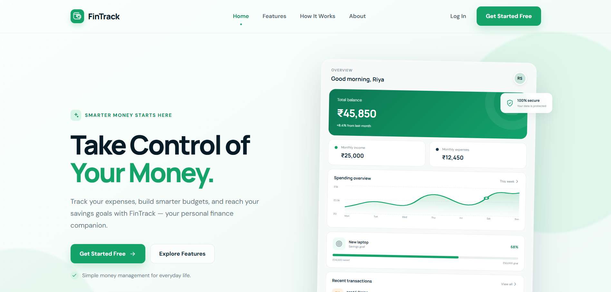
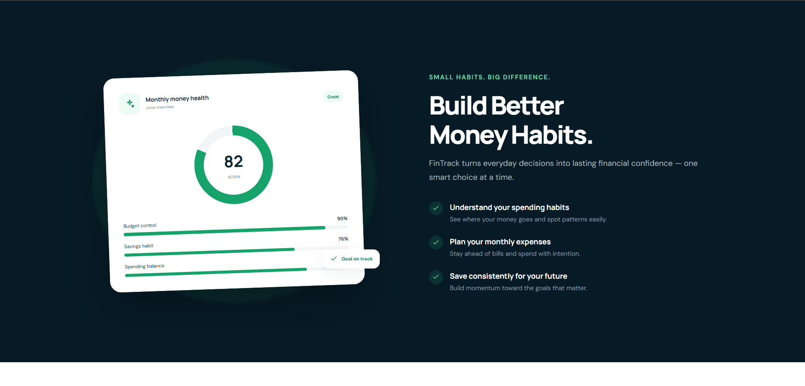
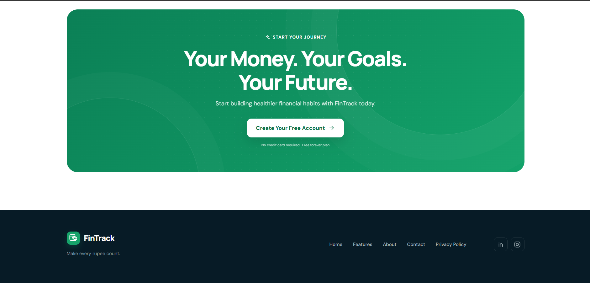

# FinTrack — Personal Finance App Landing Page

## About the Project

FinTrack is a fictional fintech startup product designed to help students and young professionals manage their personal finances.

The landing page introduces the app's features, including expense tracking, budget planning, savings goals, and financial insights.

## Project Type
UI/UX Design — Responsive Product Landing Page

## Target Audience
- College and university students
- Fresh graduates
- Young professionals
- People who want to improve their financial habits

## Objectives
- Create a visually appealing landing page.
- Design desktop and mobile layouts.
- Practice Figma Auto Layout.
- Create reusable UI components.
- Maintain consistent colors, typography, and spacing.

## Key Features
- Smart expense tracking
- Easy budget planning
- Savings goal tracking
- Financial dashboard preview
- Responsive design for desktop and mobile
- Call-to-action buttons for user registration

## Design Tools
- Figma
- Figma Auto Layout
- Reusable Components and Variants
- Shared Color and Typography Styles

## Color Palette
- Primary: Emerald Green
- Secondary: Dark Navy
- Background: White
- Accent: Light Mint Green
- Text: Dark Charcoal

## Figma Design
**Figma Project Link:** [Add your Figma link here]

## Screenshots

### 1. Desktop Landing Page

The main FinTrack landing page features a navigation bar, hero section, financial dashboard preview, and a clear call-to-action for users.

### 2. Features Section

This section highlights the main features of FinTrack, including expense tracking, budget planning, and savings goals.

### 3. About Design

This section presents additional information about the FinTrack product and its purpose of helping users manage their personal finances.

### 4. Final Page — Call to Action and Footer

The final section encourages users to start managing their finances with FinTrack. It includes a prominent call-to-action button, product information, navigation links, and copyright details.

## Learning Outcomes
- Understanding responsive UI/UX design
- Using Auto Layout to create flexible layouts
- Building reusable components
- Applying consistent typography and color styles
- Organizing and documenting a design project

## Disclaimer
FinTrack is a fictional product created for educational purposes. All financial figures shown in the design are sample data.

## Author
Student UI/UX Design Project
